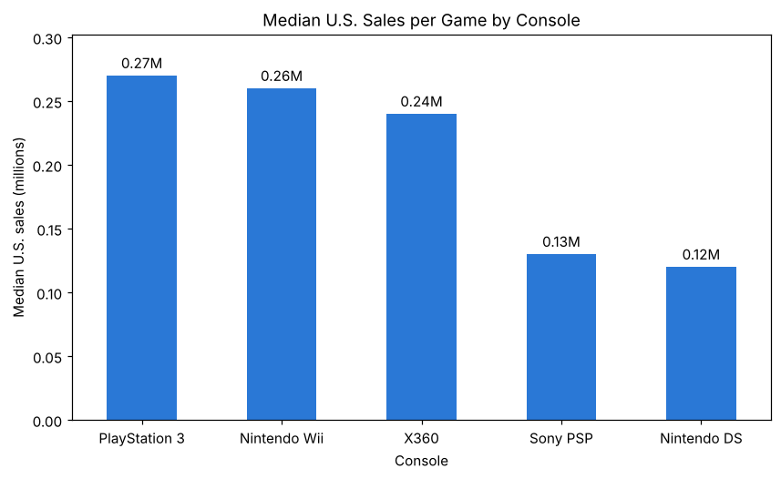

# U.S. Video Game Sales by Console: Mean vs. Median


**Which console's games sell best in the U.S.? It depends on which "average" you trust.**

An exploratory data analysis of 1,770 games across five consoles (Xbox 360, PlayStation 3, Nintendo Wii, Nintendo DS and Sony PSP), comparing mean and median U.S. sales per game.

*Jai Sivaya and Liam Patel, STAT 207 (Data Science Exploration), University of Illinois Urbana-Champaign, Spring 2026. Both authors worked on all parts of the project. The original repository is [sivayajai07/video-game-sales-by-console](https://github.com/sivayajai07/video-game-sales-by-console).*



## Key findings

| Console | Games | Mean sales per game | Median sales per game |
|---|---:|---:|---:|
| Nintendo Wii | 296 | **0.69M** | 0.26M |
| Xbox 360 | 437 | 0.55M | 0.24M |
| PlayStation 3 | 312 | 0.46M | **0.27M** |
| Nintendo DS | 418 | 0.45M | 0.12M |
| Sony PSP | 307 | 0.24M | 0.13M |

- U.S. sales per game are **heavily right-skewed**: most games sell under 0.5M copies, while a few blockbusters reach almost 15M.
- The **Wii leads on mean but not on median**. A handful of hits inflate its average, so the **PS3 has the strongest typical game**.
- **Takeaway:** when a few outliers dominate, the median is the better guide to what a typical release can expect, which matters for decisions like platform selection or sales forecasting.

## How it works

The notebook walks through a full exploratory analysis:

1. **Load and inspect** the dataset with pandas and pick the variables that answer the question (`Console`, `US Sales (millions)`).
2. **Clean** by checking for missing values and deciding to keep high outliers, since they are real blockbuster titles.
3. **Summarize** with a grouped count, mean, median and standard deviation per console.
4. **Visualize** with log-scale box plots to show the skew, and a bar chart of median sales per console.
5. **Conclude** with the mean vs. median comparison and the limits of the data (U.S. only, five consoles, no genre or marketing controls).

## Data

The analysis uses a U.S. video game sales dataset (games released 2004 to 2010) collected by Joe Cox:

> Cox, J. (2014). What makes a blockbuster video game? An empirical analysis of US sales data. *Managerial and Decision Economics*, 35(3), 189 to 198. Dataset published by the University of Portsmouth, DOI 10.17029/d4fe28cd-1e44-4d2f-9db6-85b347bf761e.

The CSV is not included in this repository. To run the notebook, get the dataset from its source, save it as `video_games.csv` in the project folder, and make sure it has the `Console` and `US Sales (millions)` columns.

## Run it locally

```bash
git clone https://github.com/liam9107/video-game-sales-by-console.git
cd video-game-sales-by-console
python3 -m venv .venv
source .venv/bin/activate        # Windows: .venv\Scripts\activate
pip install -r requirements.txt
jupyter notebook video_game_sales_by_console.ipynb
```

## Screenshots

| Median sales per game | Sales distribution (log scale) |
|---|---|
|  | _Add a screenshot of the box plot here_ |

## Files

| File | Description |
|---|---|
| `video_game_sales_by_console.ipynb` | Data cleaning, grouped summary statistics, log-scale box plots and median comparison |
| `median_sales_by_console.png` | Chart of median U.S. sales per game by console |
| `requirements.txt` | Python packages needed to run the notebook |
